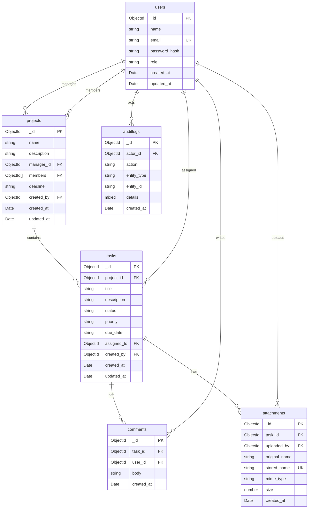

# Entity Relationship Diagram (ERD) - MongoDB

The data model uses **MongoDB collections** with document references to model relationships between users, projects, tasks, comments, attachments, and audit logs.

## Relationship & Integrity Rules

- **Projects**: Each project is managed by a single user (`manager_id` with role `PROJECT_MANAGER` or `ADMIN`) and maintains an array of assigned team members (`members`).
- **Tasks**: Belongs to a project (`project_id`). Can be assigned to a team member (`assigned_to`) who belongs to the project team.
- **Comments & Attachments**: Scoped directly to tasks (`task_id`). When a task or project is deleted, related comments and attachment documents/files are cleaned up.
- **Audit Logs**: Maintain independent system activity logs with actor reference and structured JSON details.
