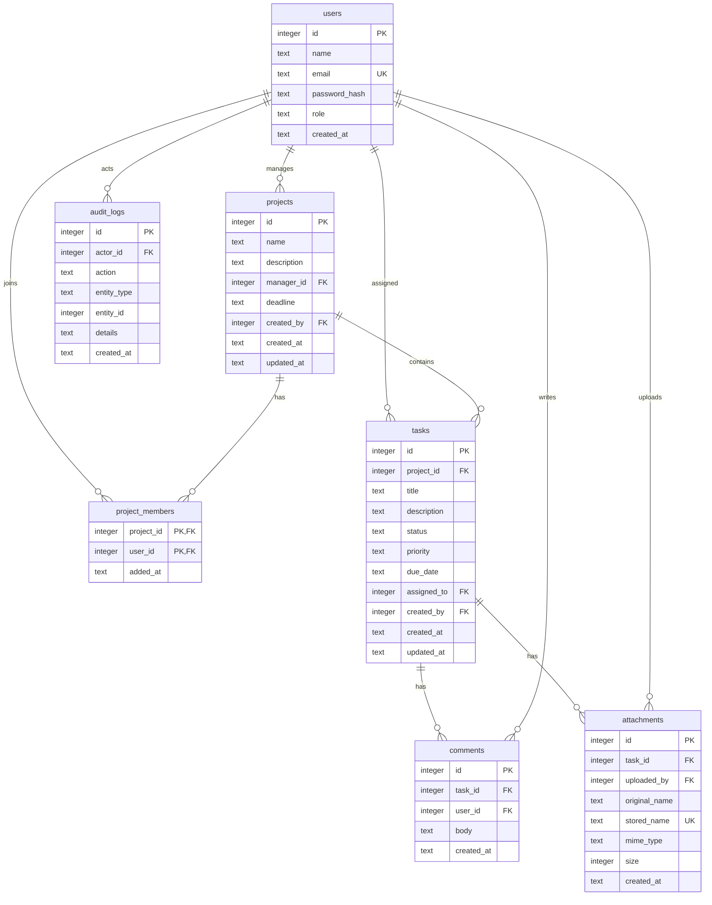

# Groundwork ER Diagram

Groundwork uses a small relational model: users own and join projects, projects
contain tasks, and tasks carry comments and file attachments. Audit entries are
kept separately so activity history survives normal edits.

## Relationship rules

- A project has one manager. That person must have the `PROJECT_MANAGER` or
  `ADMIN` role.
- The manager is also inserted into `project_members`, so team membership can be
  queried in one place.
- Removing a project cascades to its memberships, tasks, comments, and
  attachment records. Attachment files are removed from disk by the API.
- Removing a user is not exposed by the API. `projects.manager_id` is
  `ON DELETE RESTRICT`; task assignments and upload references become `NULL`.
- A task assignee must be the project manager or a member of that project.
- Audit log details are stored as JSON text and returned as parsed JSON by the
  API.
